# Pardha 4.0 Entity Relationship Diagram

```mermaid
erDiagram
    tenants ||--o{ businesses : owns
    tenants ||--o{ auth_users : contains
    auth_users ||--o{ auth_sessions : has
    auth_users ||--o{ conversation_sessions : starts

    businesses ||--o{ conversation_sessions : scopes
    conversation_sessions ||--o{ conversation_messages : contains
    conversation_sessions ||--|| conversation_context : has
    conversation_sessions ||--o{ conversation_timeline_events : records
    conversation_sessions ||--o{ conversation_memory : stores
    conversation_sessions ||--o{ voice_sessions : uses
    conversation_sessions ||--o{ learning_events : produces
    conversation_sessions ||--o{ execution_trace : traces

    conversation_intents ||--o{ capability_routes : maps
    specialists ||--o{ capability_routes : selected_by
    reasoning_models ||--o{ capability_routes : reasoned_by
    mcp_servers ||--o{ capability_routes : exposes

    businesses ||--o{ business_memory : stores
    auth_users ||--o{ founder_memory : stores
    specialists ||--o{ specialist_memory : stores
    learning_events ||--o{ learning_memory : informs

    businesses ||--o{ knowledge : owns
    businesses ||--o{ marketing_campaigns : owns
    marketing_campaigns ||--o{ marketing_content : produces
    marketing_campaigns ||--o{ marketing_calendar_items : schedules
    marketing_campaigns ||--o{ marketing_analytics : measures

    businesses ||--o{ sales_companies : owns
    sales_companies ||--o{ sales_contacts : has
    sales_companies ||--o{ sales_leads : generates
    sales_leads ||--o{ sales_deals : creates
    sales_leads ||--o{ sales_activities : has

    businesses ||--o{ planning_goals : owns
    planning_goals ||--o{ execution_plans : has
    execution_plans ||--o{ execution_plan_nodes : contains
    execution_plans ||--o{ plan_approvals : gates
    execution_plans ||--o{ plan_executions : runs

    capabilities ||--o{ capability_executions : runs
    capabilities ||--o{ tool_runtime_invocations : invokes
    runtime_executions ||--o{ tool_runtime_invocations : calls
```

## Notes

- `conversation_sessions` remains the canonical conversation root.
- `conversation_context` stores the active module/business/specialist/goal snapshot without polluting every message.
- `conversation_intents`, `capability_routes`, `specialists`, `reasoning_models`, and `mcp_servers` form the v4 routing layer.
- Specialist tables are internal orchestration support; they are not founder-facing chat endpoints.
- Memory is split by owner/scope to prevent cross-business and cross-specialist pollution.
