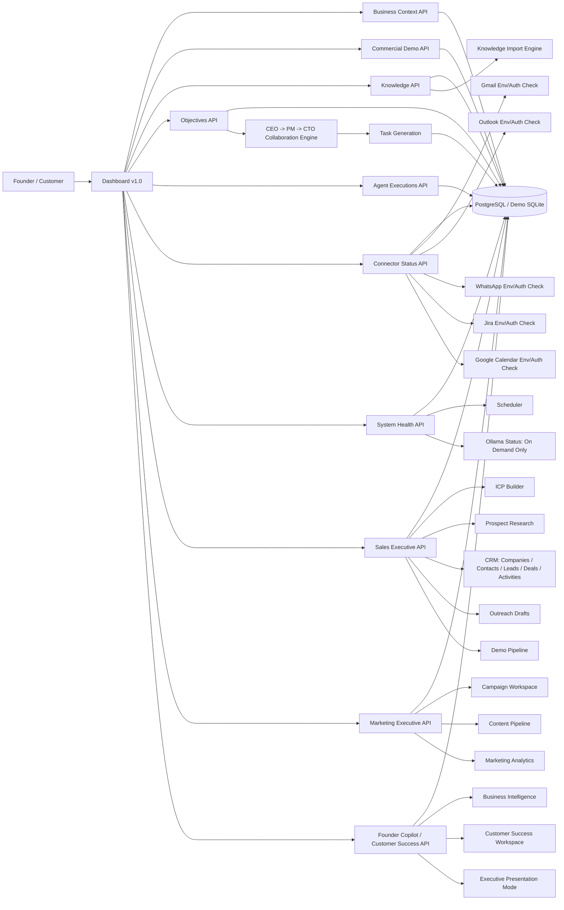

# Pardha Commercial MVP Architecture

## Runtime Profiles

- Development/demo can override `DATABASE_URL`, for example `sqlite:////private/tmp/pardha_commercial_demo.db`.
- Default production database remains `postgresql+psycopg2:///pardha_core`.
- `PARDHA_MODE` defaults to `DEVELOPMENT`; production should set `PARDHA_MODE=PRODUCTION`.
- Ollama remains disabled or idle unless explicit manual reasoning endpoints are invoked.

## Commercial Readiness Surfaces

- `GET /commercial/founder-dashboard`
- `GET /commercial/connectors/status`
- `POST /commercial/connectors/{provider}/test`
- `GET /commercial/system/health`
- `GET /commercial/demo/journey`
- `POST /commercial/demo/dp360`
- `POST /sales/prospect`
- `GET /sales/leads`
- `GET /sales/pipeline`
- `GET /sales/demos`
- `GET /sales/summary`
- `GET /sales/dashboard`
- `GET /sales/leads/{lead_id}/outreach`
- `POST /sales/leads/{lead_id}/schedule-demo`
- `POST /sales/leads/{lead_id}/stage`
- `POST /marketing/campaign`
- `GET /marketing/campaigns`
- `GET /marketing/analytics`
- `GET /marketing/content`
- `GET /marketing/summary`
- `GET /marketing/dashboard`
- `POST /copilot/founder`
- `GET /copilot/business-intelligence`
- `GET /copilot/customer-workspace`
- `GET /copilot/executive-briefs`
- `GET /copilot/health-dashboard`
- `POST /copilot/consultant`
- `POST /copilot/onboarding`
- `GET /copilot/demo-library`
- `POST /copilot/demo-library/load`
- `GET /copilot/presentation`
- `GET /copilot/commercial-readiness`
