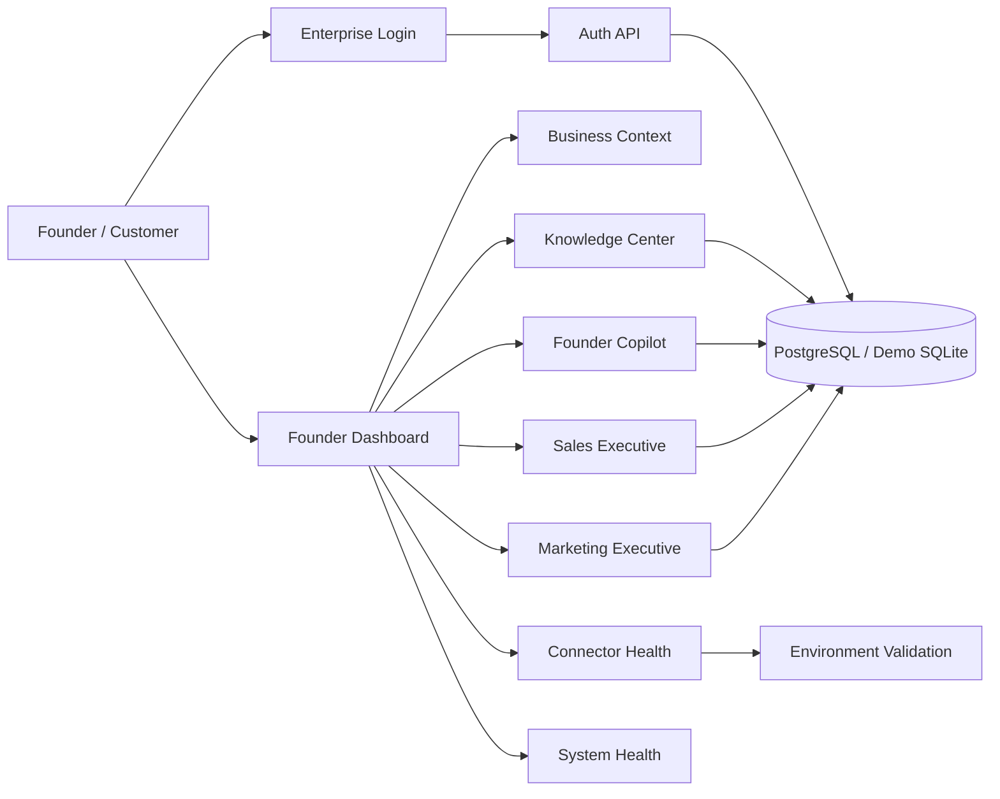

# Pardha DP360 v1.0 Release Candidate

## Release Status

Pardha v1.0 is feature-complete for founder-led DP360 demonstrations and pilot onboarding.

Sprint completion score: 97/100.

## Release Notes

Added in final commercialization sprint:

- Enterprise login screen
- Email/password authentication
- PBKDF2 password hashing
- Database-backed opaque sessions
- Remember Me
- Logout
- Founder profile
- Business selection after login
- UI route protection
- Environment-based admin bootstrap
- Knowledge Center file upload
- Multi-file upload
- Duplicate detection
- Import history
- Knowledge search
- File preview
- Delete knowledge
- Re-import
- Dark/light mode toggle
- Demo workspace coverage for DP360 Retail, Cloud Kitchen, E-commerce, EatOnTime Demo, and SaaS Startup

## Architecture



## API Documentation

Authentication:

- `POST /auth/login`
- `GET /auth/session`
- `GET /auth/profile`
- `POST /auth/logout`
- `GET /auth/security`

Knowledge Center:

- `POST /knowledge/upload`
- `GET /knowledge/imports`
- `GET /knowledge/search`
- `GET /knowledge`
- `DELETE /knowledge/{knowledge_id}`
- `POST /knowledge`

Commercial surfaces:

- `POST /copilot/founder`
- `POST /copilot/onboarding`
- `GET /copilot/demo-library`
- `POST /copilot/demo-library/load`
- `GET /copilot/commercial-readiness`
- `GET /commercial/connectors/status`
- `POST /commercial/connectors/{provider}/test`

## Deployment Guide

Required production environment:

- `DATABASE_URL`
- `PARDHA_MODE=PRODUCTION`
- `PARDHA_ADMIN_EMAIL`
- `PARDHA_ADMIN_PASSWORD` or `PARDHA_ADMIN_PASSWORD_HASH`

Optional live connector environment:

- Gmail: `GMAIL_CLIENT_ID`, `GMAIL_CLIENT_SECRET`, `GMAIL_REFRESH_TOKEN`
- Outlook: `OUTLOOK_CLIENT_ID`, `OUTLOOK_CLIENT_SECRET`, `OUTLOOK_TENANT_ID`, `OUTLOOK_REFRESH_TOKEN`
- WhatsApp: `PARDHA_WHATSAPP_ACCESS_TOKEN`, `PARDHA_WHATSAPP_PHONE_NUMBER_ID`
- Jira: `JIRA_URL`, `JIRA_EMAIL`, `JIRA_API_TOKEN`, `JIRA_PROJECT_KEY`
- Google Calendar: `GOOGLE_CALENDAR_CLIENT_ID`, `GOOGLE_CALENDAR_CLIENT_SECRET`, `GOOGLE_CALENDAR_REFRESH_TOKEN`

Run backend:

```bash
uvicorn app.main:app --host 127.0.0.1 --port 8000
```

Run dashboard:

```bash
cd dashboard
npm run dev -- --host 127.0.0.1 --port 5174
```

## Founder User Guide

1. Log in with the configured founder account.
2. Select or create a business.
3. Open Knowledge Center and upload documents.
4. Confirm imports and duplicate detection.
5. Open Founder Copilot and create an objective.
6. Review CEO, PM, CTO, Sales, Marketing, and Operations briefs.
7. Open Business Health for readiness and risk status.
8. Open Presentation for customer meeting mode.

## Demo Script

1. Log in.
2. Load DP360 Demo.
3. Show business selector.
4. Upload a Markdown or JSON knowledge file.
5. Show import history and duplicate detection.
6. Run Founder Copilot with: `I want to increase repeat purchases by 20%.`
7. Show Objectives and Tasks.
8. Show CEO, PM, and CTO tabs.
9. Show Sales and Marketing tabs.
10. Show Connector Status with honest environment validation.
11. Show Presentation mode.
12. Show Commercial Readiness score.

## Commercial Validation

Latest automated validation:

- Backend regression: 77 tests passed
- Dashboard production build: passed
- Authentication: passed
- Knowledge upload: passed
- Duplicate detection: passed
- Knowledge delete: passed
- Demo library: passed
- Commercial readiness target: 95+/100

## Known Issues

- Live connector actions require customer-provided credentials.
- PDF/DOCX/PPTX text extraction is demo-safe fallback text unless a production parser is added.
- Presentation mode is dashboard-rendered; PDF export remains backlog.

## Technical Debt

- Replace demo-safe document extraction fallback with production parsers.
- Persist commercial validation history over time.
- Add role-based access controls beyond founder/admin.
- Add production CSRF and cookie-hardening if sessions move from bearer token to browser cookies.

## Version 1.1 Backlog

- Customer pilot feedback triage
- Live connector write actions
- PDF export for presentation mode
- Advanced document parsing
- Admin user management
- Audit log UI
