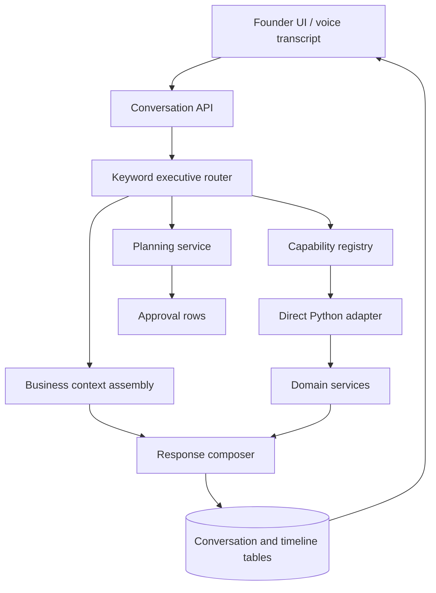

# Chief of Staff Architecture

## Current Request Path

Primary implementation: `app/conversations/service.py:176-344`.

## Implemented Strengths

- Persistent conversations and messages.
- Business-specific context snapshots.
- Structured responses containing reasoning, capabilities, evidence, confidence, execution, verification, and transparency (`app/conversations/schemas.py:83-105`).
- Capability discovery and direct execution.
- Planning and approval records.
- Connector/runtime diagnostics included in responses.
- Explicit deterministic fallback allows operation without Ollama.

## Material Gaps

1. **Routing is lexical.** `route_executive_intent` matches phrases instead of evaluating intent with a schema-constrained model.
2. **Streaming is simulated.** `stream_events` assembles events around a completed synchronous call; users do not receive token/tool progress as it occurs.
3. **Two conversation stacks coexist.** `app/chief_of_staff/service.py` and `app/conversations/service.py` overlap, increasing behavioral drift.
4. **Planning and direct execution are mixed.** Some routes execute the top capability immediately; others create plans. Risk policy is not the sole determinant.
5. **No durable workflow engine.** Process restart recovery, leases, step idempotency, compensation, and distributed concurrency are not established.
6. **Verification is mostly metadata.** Tool-specific postconditions and evidence checks are not universally required before success.
7. **Conversation memory is fragmented.** Multiple memory tables coexist with the older generic memory engine; retrieval is lexical and not consolidated.

## Controlled Scenario Findings

- “Summarize today's project status” routed to `system_health`, not project status.
- “Deploy the release and update Jira after founder approval” also routed to health inspection because Jira/diagnostic keywords dominated.
- Roadmap, sales follow-up, QA, and delegation requests created persistent plans awaiting approval.
- No scenario used LLM reasoning under deterministic configuration.
- Cross-business test did not leak the marker from DP360 into EatOnTime output.

## Chief of Staff Readiness

| Capability | Ready % | Reason |
|---|---:|---|
| Conversation persistence | 85 | Durable messages/timeline exist |
| Business awareness | 75 | Queries are filtered; active context is process scoped |
| Intent understanding | 35 | Keyword router misclassifies compound requests |
| Planning | 55 | Graph persisted; execution/dependency semantics incomplete |
| Delegation | 40 | Capability lists, not independent accountable workers |
| HITL | 45 | Present in planning, inconsistent at tool boundaries |
| Explainability | 70 | Strong response schema, evidence quality varies |
| Recovery | 30 | No robust workflow replay/lease semantics |
| Streaming | 20 | Buffered event sequence |

**Chief of Staff readiness: 51%.**

