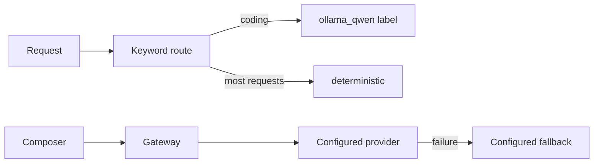

# Model Provider and Routing

## Provider Matrix

| Provider | Generation | Health | Streaming | Tool calling | Cost/tokens | Status |
|---|---|---|---|---|---|---|
| Deterministic | Template output | Always available | No | No | Request count only | Implemented |
| Ollama | Real `/api/generate` HTTP | Real endpoint/model checks | Client requests non-streaming | No native tool loop | In-memory count | Implemented, optional |
| OpenAI | Raises “not enabled” | Reports ready from API-key presence | No | No | No | Config-only/broken |
| Claude | No generation client | Stub | No | No | No | Stub |
| Gemini | No generation client | Stub | No | No | No | Stub |

Evidence: `app/reasoning/gateway.py:13-199`, `app/reasoning/client.py:79-256`, `app/ai/provider_manager.py:92-230`.

## Current Selection Logic

- Defaults: Ollama disabled, deterministic provider, `llama3.2:3b`, optional `qwen3:8b`, concurrency one (`app/settings.py:45-71`).
- The router chooses model labels from intent rules, not live latency, cost, context length, capability, or confidence.
- The gateway fallback is provider-level exception handling, not policy-based model routing (`app/reasoning/gateway.py:153-199`).
- Usage metrics are in memory and count requests; they do not persist tokens, price, or per-business budgets (`:204-255`).

## Provider Availability Finding

Local Ollama model availability was not verified during the audit. No inference was started, because the audit forbade downloads and unnecessary runtime changes.

## Accuracy and Safety Risks

1. OpenAI can appear connected when a key is present even though generation is intentionally disabled.
2. Provider “test” semantics vary: OpenAI tests configuration; Ollama performs inference.
3. No structured-output validation/retry loop is applied consistently to planning/routing.
4. No prompt registry/version persistence is used by the main composer despite governance models existing elsewhere.
5. No data-classification policy decides whether business content may leave the machine.
6. Fallback to deterministic output can silently reduce answer quality unless surfaced to the founder.

## Recommended Routing Contract

Route by task properties, not agent name:

| Task class | Preferred route | Fallback |
|---|---|---|
| Status/aggregation | Deterministic tools | None; report data failure |
| Intent classification | Small structured model | Deterministic rules with low-confidence warning |
| Planning | Strong cloud model or proven local model | Draft-only local plan |
| Sensitive summarization | Local model | Deterministic extractive summary |
| Code review | Coding-capable model + repository tools | Human review required |
| External write | Any planner -> central HITL gate | Never auto-fallback to write |

Persist provider, model, prompt version, latency, token usage, estimated cost, data classification, confidence, and fallback reason for every model call.

