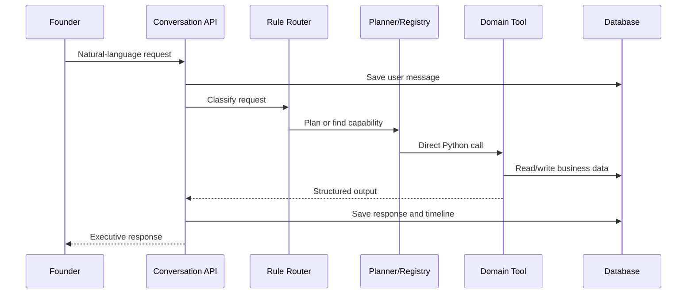

# Agent Communication and API Map

## Communication Mechanisms

| Mechanism | Implementation | Actual behavior |
|---|---|---|
| Event bus | `app/events/bus.py:52-102` | Inserts and queries database rows; no subscribers/broker |
| Collaboration | `app/collaboration/service.py:220-285` | Synchronous scripted CEO -> PM -> CTO workflow |
| Capability registry | `app/capabilities/service.py:106-207` | Scores and invokes direct Python adapters |
| Planning graph | `app/planning/service.py` | Persists nodes/dependencies/approvals; runs mostly sequentially |
| Runtime queue | `app/runtime/service.py:123-216` | Persistent local queue and execution records |
| MCP runtime | `app/mcp/execution/service.py:15-47` | In-process adapter call with history; not external MCP transport |
| Conversation timeline | `app/conversations/service.py` | Durable user/assistant and lifecycle records |

No evidence was found of Kafka, RabbitMQ, Redis Streams, NATS, Celery, Temporal, or another durable asynchronous orchestration engine.

## Core API Surface

| Domain | Prefix / important endpoints | Notes |
|---|---|---|
| Health/system | `/`, `/system/*`, `/commercial/system/health` | Multiple overlapping status models |
| Auth | `/auth/login`, `/auth/session`, `/auth/profile`, `/auth/logout` | Protection not globally applied |
| Businesses | `/businesses`, `/context/switch`, `/context/current` | Active context is global process state |
| Conversation | `/conversations`, `/conversations/messages`, `/conversations/stream` | New canonical stack |
| Legacy Chief of Staff | `/chief-of-staff/chat`, `/goals`, `/executive-command` | Overlaps conversation/planning |
| Capabilities | `/capabilities/*`, `/kernel/execute`, `/kernel/resolve` | Dynamic registry with direct adapters |
| Planning | `/planning/plan`, `/plans/*`, `/approvals`, `/daily` | HITL records and graph |
| Runtime | `/runtime/executions`, `/queue`, `/automation`, `/dashboard` | Local execution layer |
| Knowledge | `/knowledge/upload`, `/search`, `/imports`, `/summary` | Extraction and lexical search |
| Collaboration | `/objectives`, `/collaborations`, `/tasks` | Deterministic executive flow |
| Providers | `/ai/providers/*`, `/status/ollama`, `/agents/*/reason` | Mixed real and stub providers |
| Connectors | `/jira/*`, `/hubspot/*`, `/commercial/connectors/*`, `/mcp/*` | Safety semantics differ by path |
| Enterprise | `/enterprise/*` | Administration/governance/status surfaces |
| Factory | `/software-factory/*` | Planning artifacts, approvals, dashboards |

## Request/Response Path Example

## Contract Risks

- The API surface contains duplicate concepts: goals/objectives, two conversation stacks, several health endpoints, several approval types.
- Domain services can be called directly, bypassing the conversation planner and approval controls.
- Capability health can indicate registry availability without validating downstream dependency health.
- There is no consistent idempotency key on external action endpoints.
- Event records are not guaranteed delivery mechanisms.
- Active business switching is unsafe for concurrent users because it is not bound to authenticated session/tenant context.

## Consolidation Recommendation

Designate `/conversations`, `/planning`, `/capabilities`, `/runtime`, and a central `/approvals` service as canonical. Keep domain APIs internal or require the same policy middleware. Deprecate the legacy Chief-of-Staff endpoints after migration, and distinguish audit events from durable commands/events.

