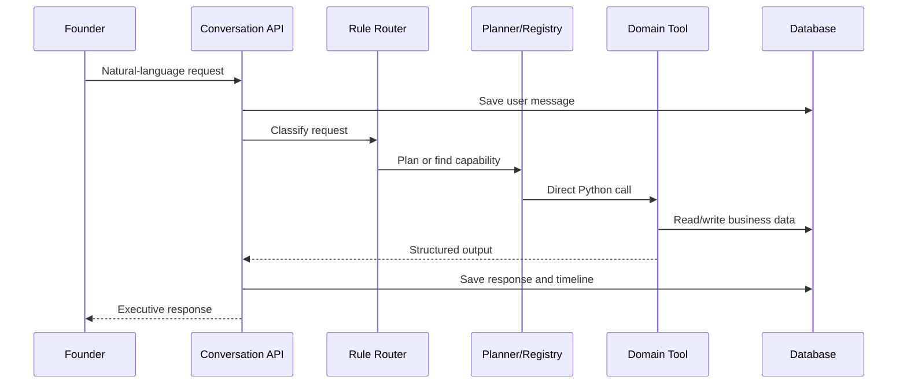

# Agent Communication and API Map

## Communication Mechanisms

| Mechanism | Implementation | Actual behavior |
|---|---|---|
| Event bus | `app/events/bus.py:52-102` | Inserts and queries database rows; no subscribers/broker |
| Collaboration | `app/collaboration/service.py:220-285` | Synchronous scripted CEO -> PM -> CTO workflow |
| Capability registry | `app/capabilities/service.py:106-207` | Scores and invokes direct Python adapters |
| Planning graph | `app/planning/service.py` | Persists nodes/dependencies/approvals; runs mostly sequentially |
| Runtime queue | `app/runtime/service.py:123-216` | Persistent local queue and execution records |
| MCP runtime | `app/mcp/execution/service.py:15-47` | In-process adapter call with history; not external MCP transport |
| Conversation timeline | `app/conversations/service.py` | Durable user/assistant and lifecycle records |

No evidence was found of Kafka, RabbitMQ, Redis Streams, NATS, Celery, Temporal, or another durable asynchronous orchestration engine.

## Core API Surface

Verified against the live route table of the FastAPI app object (`develop` @ `97890a1`, FastAPI 0.163.1;
included routers enumerated recursively): **245 route-method pairs**, plus the framework documentation routes
(`/openapi.json`, `/docs`, `/docs/oauth2-redirect`, `/redoc`). Full paths are shown; `*` means "and sub-paths".

| Domain | Actual prefix / important endpoints | Notes |
|---|---|---|
| Health/system | `GET /`, `/system/database/status`, `/system/ollama/{status,start,stop,switch}`, `/commercial/system/health`, `/reasoning/health` | Multiple overlapping status models; `/system/ollama/*` includes state-changing POSTs |
| Auth | `POST /auth/login`, `GET /auth/session`, `GET /auth/profile`, `POST /auth/logout`, `GET /auth/security` | API-wide enforcement in progress (PE0OM-56) |
| Businesses | `/businesses`, `/businesses/{business_id}`, `POST /context/switch`, `GET /context/current` | Context to be bound to the authenticated session (PE0OM-56) |
| Conversation | `/conversations`, `/conversations/messages`, `/conversations/stream`, `/conversations/{conversation_id}/*` | New canonical stack |
| Legacy Chief of Staff | `POST /chief/chat`, `/chief/goals`, `GET /chief/executive-command`, `/chief/conversations/*`, `GET /chief/help` | Overlaps conversation/planning |
| Capabilities | `/capabilities/*`, `POST /kernel/execute`, `POST /kernel/resolve` | Dynamic registry with direct adapters |
| Planning | `POST /planning/plan`, `/planning/plans/*` (incl. `approve`, `reject`, `execute`), `GET /planning/approvals`, `/planning/goals/*`, `GET /planning/daily` | HITL records and graph |
| Runtime | `/runtime/executions/*` (incl. `run`, `retry`, `rollback`), `/runtime/queue`, `POST /runtime/queue/process`, `/runtime/automation/rules`, `/runtime/notifications/*`, `GET /runtime/dashboard`, `/runtime/departments`, `/runtime/timeline` | Local execution layer |
| Knowledge | `/knowledge`, `POST /knowledge/upload`, `GET /knowledge/search`, `/knowledge/imports`, `/knowledge/summary`, `/knowledge/business/{business_name}` | Extraction and lexical search |
| Collaboration | `/objectives`, `/collaborations`, `GET /tasks`, `/projects`, `POST /projects/scan` | Deterministic executive flow |
| Agents | `GET /agents`, `/agents/{ceo,cto,pm}/{brief,reason,reasoning}`, `/agents/executions/*`, `POST /agents/register` | Scheduled and on-demand agent briefs |
| Providers | `/ai/providers/*`, `/status/{ollama,providers,models}` | Mixed real and stub providers |
| Memory and events | `/memories/*`, `/events/*` | Database records, not a message broker |
| Connectors | `/jira/*`, `/hubspot/*`, `/whatsapp/*`, `/communications/*`, `/commercial/connectors/*`, `/mcp/*` | Safety semantics differ by path |
| Sales and marketing | `/sales/*` (leads, demo bookings, post-demo drafts, pipeline), `/marketing/*` (incl. `/marketing/meta/*`) | Domain APIs outside the planner |
| Founder copilot and demo | `/copilot/*`, `/commercial/*` (dashboards, demo journey), `POST /demo/seed` | Demo and readiness surfaces |
| Enterprise | `/enterprise/*` | Administration/governance/status surfaces |
| Factory | `/software-factory/*` | Planning artifacts, approvals, dashboards |
| Test-only | `GET /test` | Present in normal builds; to be limited to test runs (PE0OM-76) |

Earlier drafts of this table used incorrect or relative prefixes (for example `/chief-of-staff/*`, and
`/plans`, `/queue` or `/search` without their `/planning`, `/runtime` and `/knowledge` prefixes). Code line
references in the table above the API surface refer to `develop` @ `97890a1`.

## Request/Response Path Example

## Contract Risks

- The API surface contains duplicate concepts: goals/objectives, two conversation stacks, several health endpoints, several approval types.
- Not all domain endpoints route through the conversation planner and approval controls yet; a single policy layer is planned (PE0OM-56).
- Capability health can indicate registry availability without validating downstream dependency health.
- There is no consistent idempotency key on external action endpoints.
- Event records are not guaranteed delivery mechanisms.
- Active-business switching must be bound to the authenticated session and tenant context (PE0OM-56).

## Consolidation Recommendation

Designate `/conversations`, `/planning`, `/capabilities`, `/runtime`, and a central `/approvals` service as canonical. Keep domain APIs internal or require the same policy middleware. Deprecate the legacy Chief-of-Staff endpoints after migration, and distinguish audit events from durable commands/events.
