# Proposed v1 Architecture

## Design Principle

Preserve existing domain services as tools. Replace overlapping orchestration paths with one authenticated, policy-enforced execution pipeline. Do not create more nominal agents until the core loop is reliable.

```mermaid
flowchart TD
  U[Founder UI / Voice / API] --> GW[Auth + Tenant/Business Gateway]
  GW --> CO[Chief of Staff Orchestrator]
  CO --> MR[Model Router]
  CO --> CX[Context and Memory Service]
  CO --> CR[Capability Registry]
  MR --> L[Local Providers]
  MR --> C[Cloud Providers]
  CR --> PL[Structured Planner]
  PL --> PE[Policy Engine]
  PE -->|safe read| EX[Durable Executor]
  PE -->|approval required| AP[Approval Center]
  AP -->|approved token| EX
  EX --> TOOLS[Sales / Marketing / Jira / Knowledge / Engineering Tools]
  TOOLS --> VE[Verification and Reconciliation]
  VE --> AU[(Immutable Audit + Execution Store)]
  VE --> CO
  CO --> U
```

## Canonical Components

### Gateway

Authenticates every request and resolves immutable `tenant_id`, allowed `business_id`, actor, role, and trace ID. The UI must never control authorization by merely sending a business ID.

### Chief of Staff Orchestrator

Owns conversation state and workflow coordination. It never calls external clients directly. It emits structured intent and plan requests.

### Model Router

Selects a provider by task class, sensitivity, model capability, availability, measured quality, latency budget, and cost. It records model/prompt versions and fallback reasons.

### Capability Registry

Describes tools and constraints. Each capability declares read/write class, required permissions, business scope, idempotency behavior, health dependencies, input/output schemas, verification function, and compensation support.

### Policy and Approval

One non-bypassable policy decision point. Approval produces a signed, expiring authorization token bound to actor, exact action hash, business, connector, and limits. Modifying inputs invalidates approval.

### Durable Executor

Uses leases, retries with bounded backoff, idempotency keys, step dependencies, cancellation, and recovery. A database outbox is sufficient initially; adopt a workflow engine only when operational need is proven.

### Verification

Success requires tool-specific postconditions. External writes must be read back or reconciled. Partial failures become explicit states with operator actions.

## Data Boundaries

- Every operational row must carry tenant and business ownership where applicable.
- Memory retrieval must apply authorization before ranking.
- Secrets remain outside business data and are referenced through a secret manager.
- Audit history is append-only and separate from mutable operational status.

## Migration Sequence

1. Enforce auth/tenant/business dependencies globally.
2. Define canonical conversation and approval APIs; deprecate duplicates.
3. Wrap every external write as a registered capability behind policy.
4. Fix planning state transitions and add idempotent execution.
5. Implement real provider adapters and structured routing.
6. Consolidate memory and evidence retrieval.
7. Split frontend modules and add browser contract tests.
8. Add production observability and deployment automation.

This sequence reuses existing services and avoids a high-risk rewrite.
